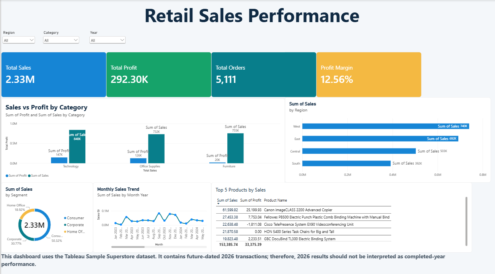

# Retail Sales Data Analysis

## Project Overview

This project focuses on analyzing retail sales data to understand business performance, sales trends, product performance, customer segments, regional performance, and profitability.

The objective is to use data analytics techniques and tools to identify meaningful business patterns, generate actionable insights, and support data-driven decision-making.

## Business Objectives

- Analyze overall sales and profitability.
- Identify top-performing and underperforming product categories.
- Evaluate regional sales performance.
- Understand customer segments and purchasing behavior.
- Explore the relationship between discounts and profit.
- Analyze monthly and yearly sales trends.
- Identify profitable and loss-making products and customers.
- Develop actionable business recommendations.

## Dataset

**Dataset:** Tableau Sample Superstore

The dataset contains retail transaction information, including:

- Order and shipping details
- Customer information
- Product categories and sub-categories
- Geographical information
- Sales, discounts, quantities, and profits

**Dataset Size:** 10,194 records and 21 columns.

## Tools & Technologies

- Python
- Pandas
- NumPy
- SQL
- Microsoft Excel
- Microsoft Power BI
- DAX
- SQLite
- Git & GitHub

## Project Workflow

1. Dataset understanding and data exploration
2. Data quality assessment
3. Data cleaning and preprocessing
4. Exploratory Data Analysis (EDA)
5. SQL-based business analysis
6. Excel analysis and reporting
7. KPI development
8. Interactive Power BI dashboard development
9. Business insights and recommendations

## Python Exploratory Data Analysis

Performed exploratory data analysis using Python and Pandas.

### Analysis Performed

- Dataset inspection and structure analysis
- Data type validation
- Missing value and duplicate checks
- Statistical analysis
- Sales and profit analysis
- Category and sub-category analysis
- Regional performance analysis
- Customer and segment analysis
- Discount and profitability analysis
- Time-based sales analysis

**Notebook:** `notebooks/01_data_exploration.ipynb`

## SQL Analysis

Prepared SQL scripts for business analysis using SQLite.

### Analysis Areas

- Data validation
- Data cleaning
- Sales performance analysis
- Customer analysis
- Product performance analysis
- Regional analysis
- Discount and profitability analysis
- Time-series analysis
- Business insights

SQL scripts are available in the `sql/` directory.

## Excel Analysis

Performed sales analysis using Microsoft Excel with PivotTables, PivotCharts, sorting, filtering, formulas, and business summaries.

### Analysis Performed

- Sales and profit analysis by product category
- Regional sales and profit comparison
- Customer-level sales and profitability analysis
- Customer segment performance
- Monthly and yearly sales trends
- Identification of top-performing and loss-making customers

### Key Business Insights

- Total Sales: $2.33 million
- Total Profit: $292,296.81
- Total Orders: 5,111
- Total Customers: 804
- Overall Profit Margin: 12.56%
- Top Sales Category: Technology
- Top Performing Region: West
- Highest Sales Segment: Consumer
- Highest Margin Segment: Home Office
- Most Profitable Customer: Tamara Chand
- Main Concern: Furniture has a relatively low profit margin.

**Excel Report:** [View Excel Analysis](reports/Retail_Sales_Analysis.xlsx)

## Power BI Dashboard

Developed an interactive Power BI dashboard to monitor retail sales performance and profitability.

### Dashboard Preview



### Key Performance Indicators

| KPI | Value |
|---|---:|
| Total Sales | $2.33M |
| Total Profit | $292.30K |
| Total Orders | 5,111 |
| Profit Margin | 12.56% |

### Dashboard Features

- Sales vs Profit by Category
- Regional Sales Performance
- Sales Distribution by Customer Segment
- Monthly Sales Trend (2023–2026)
- Top 5 Products by Sales
- Interactive slicers for Year, Region, and Category

### Key Dashboard Insights

- Technology generated the highest sales and profit among product categories.
- The West region recorded the highest sales and profit.
- Consumer customers contributed the highest sales.
- Furniture had relatively low profitability despite substantial sales.
- The Tables sub-category recorded a negative profit.

**Power BI File:** [Download Retail Sales Dashboard](dashboard/Retail_Sales_Dashboard.pbix)

## Data Quality Limitation

The Tableau Sample Superstore dataset contains future-dated transactions in 2026. Therefore, 2026 results should not be interpreted as completed-year performance.

The dataset is a sample dataset and should not be treated as actual company financial performance.

## Repository Structure

```text
retail-sales-analysis/
│
├── data/
│   ├── raw/
│   └── cleaned/
│
├── notebooks/
│   └── 01_data_exploration.ipynb
│
├── sql/
│   ├── 01_data_validation.sql
│   ├── 02_data_cleaning.sql
│   ├── 03_sales_analysis.sql
│   ├── 04_customer_analysis.sql
│   ├── 05_product_analysis.sql
│   ├── 06_regional_analysis.sql
│   ├── 07_discount_analysis.sql
│   ├── 08_time_series_analysis.sql
│   └── 09_business_insights.sql
│
├── dashboard/
│   └── Retail_Sales_Dashboard.pbix
│
├── reports/
│   └── Retail_Sales_Analysis.xlsx
│
├── images/
│   └── Retail_Sales_Dashboard.png
│
└── README.md
```

## Project Status

**Core analysis and dashboard development completed.**

- Dataset setup and initial exploration completed.
- Python exploratory data analysis completed.
- Excel sales analysis and reporting completed.
- SQL business analysis scripts prepared.
- Power BI dashboard developed and uploaded.
- Business insights documented.

## Future Improvements

- Validate and execute all SQL scripts against the project database.
- Add further SQL business analysis and interview-focused queries.
- Expand dashboard analysis with additional KPIs and drill-downs.

---

*This project demonstrates practical data analytics skills using Python, SQL, Excel, and Power BI as part of a Data Analyst portfolio.*
